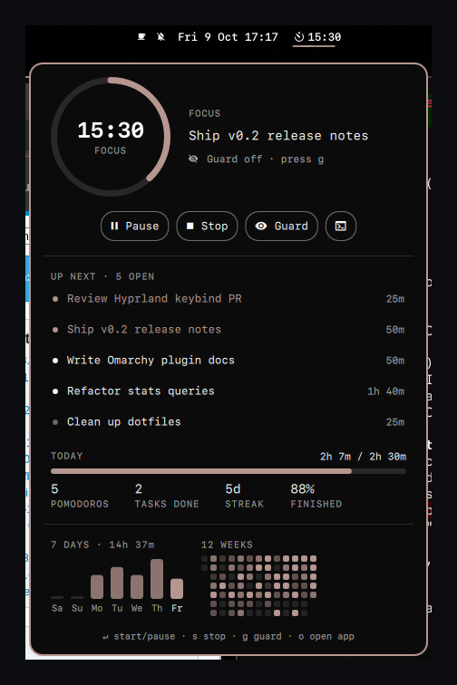
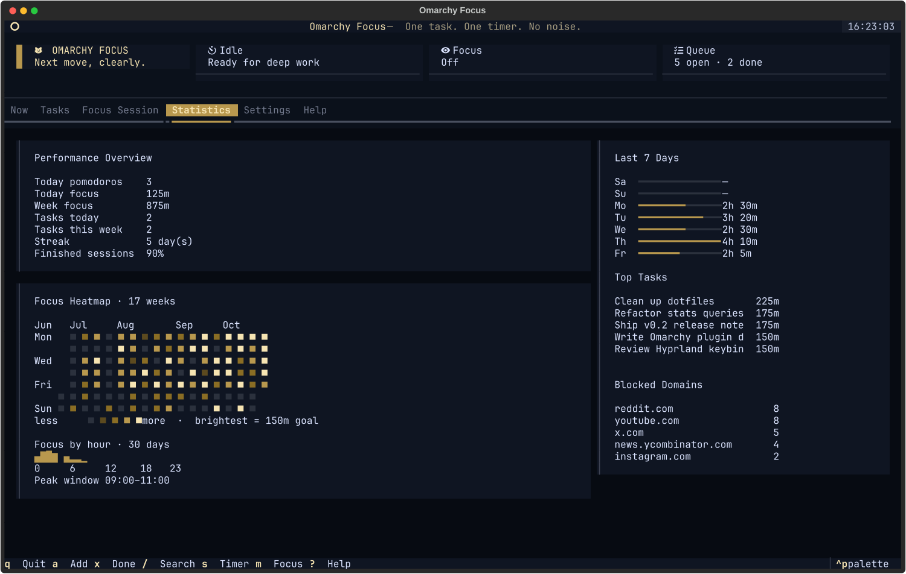

# Omarchy Focus

[English](#english) · [Türkçe](#türkçe)

Pomodoro timer, task queue and a reversible site blocker for [Omarchy](https://omarchy.org): a native bar widget, a terminal app and a CLI, all sharing one local SQLite database.

<p align="center">
  
</p>

## English

### What you get

- **Native Omarchy Shell widget.** A live countdown in the bar with a progress hairline. Click it for a panel with a progress ring, controls, your next tasks (click one to start on it), today's goal, the last 7 days and a 12-week heatmap. It follows your Omarchy theme.
- **No polling.** The widget watches a change file with inotify and counts down locally. Bar updates are instant and cost nothing while idle.
- **Terminal app (Textual).** A Now view, tasks with search and filters, the site guard, statistics and settings, all keyboard-first.
- **Site guard.** Blocks distracting sites through a marked, reversible block in `/etc/hosts`, with strict mode and crash recovery. From the bar it asks for your password through Omarchy's polkit dialog, or never asks with `--system-helper`.
- **Stats that mean something.** Daily goal, streaks, finished vs. abandoned sessions, a GitHub-style heatmap and your peak focus hours, in the panel, the TUI and `omarchy-focus stats`.

| Panel | Terminal app |
| --- | --- |
|  |  |

### Install

**AUR**

```bash
yay -S omarchy-focus
omarchy-focus widget install     # puts the widget in your bar, next to the clock
```

**From source**

```bash
git clone https://github.com/talhacaglar/omarchy-focus.git
cd omarchy-focus
./install.sh                     # add --system-helper for prompt-free site blocking
```

Needs Python 3.12+. The bar widget needs Omarchy 4 (the Quickshell-based Omarchy Shell). On other setups, `examples/waybar/` has a Waybar module.

### Use it

| Where | Action |
| --- | --- |
| Bar pill | click: panel · right-click: start / pause / resume · middle-click: site guard |
| Panel keys | `Enter` start/pause · `s` stop · `g` guard · `b`/`n` take/skip break · `o` open app |
| Keybinding | `o.bind("SUPER + ALT + F", "Focus panel", "omarchy-shell omarchy-focus toggle")` in `~/.config/hypr/bindings.lua` |
| Terminal | `omarchy-focus` opens the app; `?` lists its keys |

```bash
omarchy-focus add-task "Ship release notes" --priority high --estimate 50
omarchy-focus start --task-id 1          # --focus also blocks sites for the session
omarchy-focus break start                # or: break skip
omarchy-focus stats                      # heatmap + peak hours in the terminal
omarchy-focus settings set daily_goal_minutes 180
```

```text
Today   ━━━━━━━━━━━━━━━━━───  2h 7m / 2h 30m  ·  5 pomodoros  ·  2 tasks
Week    14h 37m  ·  5d streak  ·  78% sessions finished

    Jun   Jul     Aug       Sep     Oct
Mon   · ▒ ▓ · ▓ ▓ ░ ▒ ▓ ▒ ▓ █ ▒ █ █ █ █
      · · · · █ ▓ · ▓ ▒ ▓ █ █ · ▓ █ ▓ █
Wed   · ▓ █ · ▓ ░ ▒ · █ ▓ · ▓ █ █ ▒ ▓ █
      · ▓ ▓ · ▓ ▓ █ ▒ ▓ · █ ░ █ █ ▒ ▒ █
Fri   · ▒ ▓ · ▓ █ ▒ █ ▓ █ ▓ █ ▒ ▓ █ ▒ ▓
    · · ▒ · · · ▒ · ▒ ▒ ▒ · ▒ · · · ·
Sun · ▒ · · ▒ · ▒ · ▒ ▓ · · · █ · █ ·

Focus by hour (30 days)
        ▄▇█▆ ▄▂▂▁
0     6     12    18   23
Peak: 09:00–11:00
```

Screenshots use a generated demo database (`scripts/demo_data.py`), not personal data. Upgrading from **Clar Focus**? Your tasks and history move over automatically on first run and the `clar-focus` command still works. See [CHANGELOG.md](CHANGELOG.md) and the [technical reference](REFERENCE.md).

## Türkçe

[Omarchy](https://omarchy.org) için Pomodoro zamanlayıcısı, görev listesi ve geri alınabilir site engelleyici: yerel bar widget'ı, terminal uygulaması ve CLI, hepsi aynı yerel SQLite veritabanını kullanır.

### Neler var

- **Yerel Omarchy Shell widget'ı.** Barda canlı geri sayım ve ince ilerleme çizgisi. Tıklayınca ilerleme halkası, kontroller, sıradaki görevler (birine tıklayınca o görevle başlar), günlük hedef, son 7 gün ve 12 haftalık ısı haritası açılır. Omarchy temanızın renklerini kullanır.
- **Sürekli sorgu yok.** Widget değişiklik dosyasını inotify ile izler, geri sayımı kendisi yapar. Bar anında güncellenir, boştayken kaynak harcamaz.
- **Terminal uygulaması (Textual).** Şimdi ekranı, arama ve filtreli görevler, site koruması, istatistikler ve ayarlar; tamamen klavyeyle.
- **Site koruması.** Dikkat dağıtan siteleri `/etc/hosts` içinde işaretli ve geri alınabilir bir blokla engeller; katı mod ve çökme kurtarma içerir. Bardan açıldığında şifreyi Omarchy'nin polkit penceresiyle sorar; `--system-helper` ile hiç sormaz.
- **Anlamlı istatistikler.** Günlük hedef, seri, tamamlanan/yarım bırakılan oturumlar, GitHub tarzı ısı haritası ve en verimli saatleriniz; panelde, TUI'de ve `omarchy-focus stats` çıktısında.

### Kurulum

```bash
yay -S omarchy-focus
omarchy-focus widget install     # widget'ı bara, saatin yanına ekler
```

Kaynaktan kurmak için:

```bash
git clone https://github.com/talhacaglar/omarchy-focus.git
cd omarchy-focus
./install.sh                     # şifresiz site engelleme için: --system-helper
```

Python 3.12+ gerekir. Bar widget'ı Omarchy 4 (Quickshell tabanlı Omarchy Shell) ister; diğer kurulumlar için `examples/waybar/` içinde Waybar modülü var.

### Kullanım

- **Bar:** tık = panel · sağ tık = başlat/duraklat/devam · orta tık = site koruması
- **Panel tuşları:** `Enter` başlat/duraklat · `s` durdur · `g` koruma · `b`/`n` molayı al/atla · `o` uygulamayı aç
- **Kısayol:** `~/.config/hypr/bindings.lua` içine `o.bind("SUPER + ALT + F", "Focus panel", "omarchy-shell omarchy-focus toggle")`
- **Terminal:** `omarchy-focus` uygulamayı açar, `?` tuşları listeler; `omarchy-focus stats` ısı haritasını gösterir.

Ekran görüntüleri üretilmiş örnek veritabanıyla (`scripts/demo_data.py`) hazırlandı. **Clar Focus**'tan mı geçiyorsunuz? Görevleriniz ve geçmişiniz ilk çalıştırmada otomatik taşınır, `clar-focus` komutu çalışmaya devam eder.

## License

MIT
