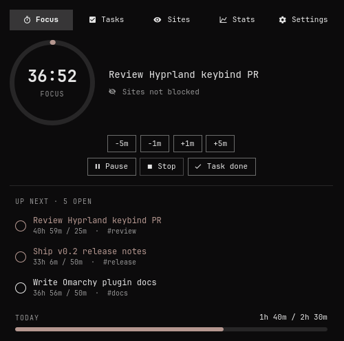
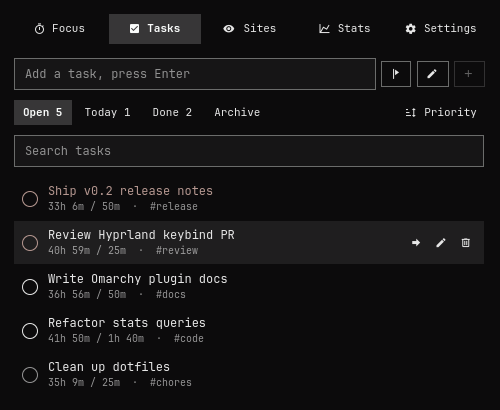
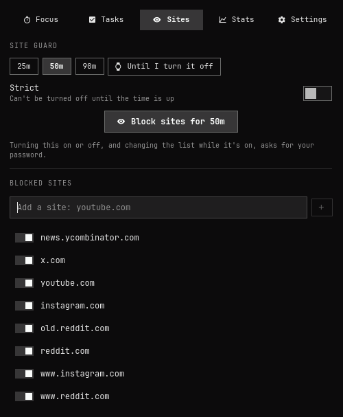
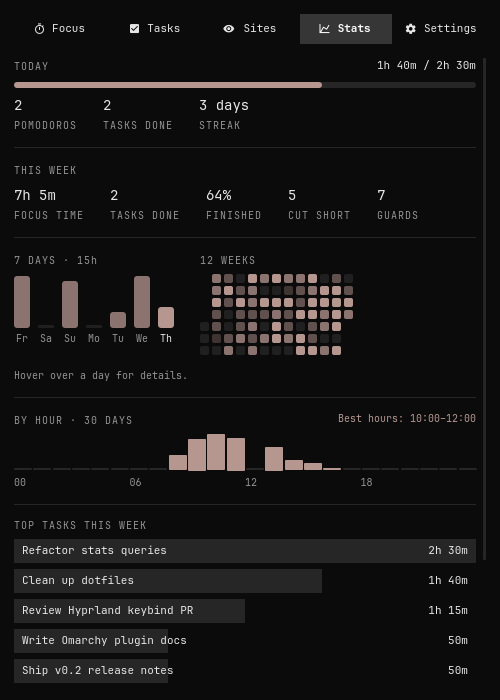

# Omarchy Focus

[English](#english) · [Türkçe](#türkçe)

Pomodoro timer, task queue and a reversible site blocker that live in the [Omarchy](https://omarchy.org) bar. Click the pill and everything is there: no app to open. A CLI on the same local SQLite database covers scripts and keybindings.

<p align="center">
  
</p>

## English

### What you get

- **The whole app in one bar panel.** A live countdown in the bar with a progress hairline. Click it for five pages: Focus, Tasks, Sites, Stats and Settings. It follows your Omarchy theme and language, with English and Turkish included.
- **Change the time as you go.** Add or take away minutes while a session runs or sits paused, or scroll on the pill. Pick the length before you start, or type any number of minutes (it sticks until you pick another), or **No timer** to count up until you stop, and the length of the break it earns.
- **Tasks.** Add one in a line, or with description, priority, estimate, tags and a due date. Filter by open, today, done and archive, search, sort, start a session on a task, or point the running session at another one without losing its time.
- **Site guard.** Blocks distracting sites through a marked, reversible block in `/etc/hosts`, with strict mode and crash recovery. Add, rename, switch off or remove sites in the panel. It asks for your password through Omarchy's polkit dialog, or never asks with `--system-helper`.
- **Stats that mean something.** Daily goal, streaks, finished vs. abandoned sessions, a 12-week heatmap, your peak focus hours, top tasks and most-blocked sites, in the panel and in `omarchy-focus stats`.
- **No polling.** The widget watches a change file with inotify and counts down locally. Bar updates are instant and cost nothing while idle.

| Tasks | Sites | Stats |
| --- | --- | --- |
|  |  |  |

### Install

**AUR**

```bash
yay -S omarchy-focus
omarchy-focus widget install     # puts the widget in your bar, next to the clock
```

**From source**

```bash
git clone https://github.com/talhacaglar/omarchy-focus.git
cd omarchy-focus
./install.sh                     # add --system-helper for prompt-free site blocking
```

Needs Python 3.12+. The panel needs Omarchy 4 (the Quickshell-based Omarchy Shell). On other setups you get the CLI, and `examples/waybar/` has a Waybar module.

### Use it

| Where | Action |
| --- | --- |
| Bar pill | click: panel · right-click: start / pause / resume · middle-click: site guard · scroll: add or take away minutes |
| Panel keys | `1`–`5` or `h`/`l` pages · `Enter` start/pause · `+`/`-` a minute more or less · `a` add task · `s` stop · `g` guard · `b`/`n` take/skip break |
| Keybinding | `o.bind("SUPER + ALT + F", "Focus panel", "omarchy-shell omarchy-focus toggle")` in `~/.config/hypr/bindings.lua` |
| Language | follows Omarchy; set `"language": "tr"` on the widget's entry in `shell.json` to pick one for this panel alone |

The same things from a terminal:

```bash
omarchy-focus                            # opens the panel
omarchy-focus add-task "Ship release notes" --priority high --estimate 50
omarchy-focus start --task-id 1          # --focus also blocks sites for the session
omarchy-focus adjust 5                   # five more minutes; adjust -5 for fewer
omarchy-focus break start                # or: break skip
omarchy-focus stats                      # heatmap + peak hours in the terminal
omarchy-focus settings set daily_goal_minutes 180
```

Screenshots use a generated demo database (`scripts/demo_data.py`), not personal data. Upgrading from **Clar Focus**? Your tasks and history move over automatically on first run and the `clar-focus` command still works. See [CHANGELOG.md](CHANGELOG.md) and the [technical reference](REFERENCE.md).

## Türkçe

[Omarchy](https://omarchy.org) çubuğunda yaşayan Pomodoro zamanlayıcısı, görev listesi ve geri alınabilir site engelleyici. Sayaca tıklayınca her şey orada: açılacak ayrı bir uygulama yok. Aynı yerel SQLite veritabanını kullanan CLI, betikler ve kısayollar içindir.

### Neler var

- **Tek panelde tüm uygulama.** Çubukta canlı geri sayım ve ince ilerleme çizgisi. Tıklayınca beş sayfa açılır: Odak, Görevler, Siteler, İstatistik ve Ayarlar. Omarchy temanızı ve dilinizi izler; İngilizce ve Türkçe hazır gelir.
- **Süreyi yolda değiştirin.** Oturum sürerken ya da duraklatılmışken dakika ekleyip çıkarın, ya da sayaç üzerinde tekerleği çevirin. Başlamadan önce süreyi seçin ya da istediğiniz dakikayı yazın (bir dahaki sefere de o gelir), isterseniz siz bitirene kadar sayan **Süresiz** odağı seçin; oturum bitince de mola süresini belirleyin.
- **Görevler.** Tek satırda ya da açıklama, öncelik, tahmini süre, etiket ve son tarihle ekleyin. Açık, bugün, biten ve arşiv olarak süzün, arayın, sıralayın, görevle oturum başlatın ya da süren oturumu süresini kaybetmeden başka bir göreve bağlayın.
- **Site engeli.** Dikkat dağıtan siteleri `/etc/hosts` içinde işaretli ve geri alınabilir bir blokla engeller; katı mod ve çökme kurtarma içerir. Siteleri panelden ekleyin, düzenleyin, kapatın, kaldırın. Şifreyi Omarchy'nin polkit penceresiyle sorar; `--system-helper` ile hiç sormaz.
- **Anlamlı istatistikler.** Günlük hedef, seri, tamamlanan/yarım bırakılan oturumlar, 12 haftalık ısı haritası, en verimli saatler, en çok çalışılan görevler ve en çok engellenen siteler; panelde ve `omarchy-focus stats` çıktısında.
- **Sürekli sorgu yok.** Widget değişiklik dosyasını inotify ile izler, geri sayımı kendisi yapar. Çubuk anında güncellenir, boştayken kaynak harcamaz.

### Kurulum

```bash
yay -S omarchy-focus
omarchy-focus widget install     # widget'ı bara, saatin yanına ekler
```

Kaynaktan kurmak için:

```bash
git clone https://github.com/talhacaglar/omarchy-focus.git
cd omarchy-focus
./install.sh                     # şifresiz site engelleme için: --system-helper
```

Python 3.12+ gerekir. Panel, Omarchy 4 (Quickshell tabanlı Omarchy Shell) ister; diğer kurulumlarda CLI çalışır, `examples/waybar/` içinde de Waybar modülü var.

### Kullanım

- **Çubuk:** tık = panel · sağ tık = başlat/duraklat/devam · orta tık = site engeli · tekerlek = dakika ekle/çıkar
- **Panel tuşları:** `1`–`5` veya `h`/`l` sayfalar · `Enter` başlat/duraklat · `+`/`-` bir dakika ekle/çıkar · `a` görev ekle · `s` durdur · `g` engel · `b`/`n` molayı al/atla
- **Kısayol:** `~/.config/hypr/bindings.lua` içine `o.bind("SUPER + ALT + F", "Focus panel", "omarchy-shell omarchy-focus toggle")`
- **Dil:** Omarchy'yi izler; yalnızca bu panelin dilini seçmek için `shell.json` içindeki widget kaydına `"language": "tr"` ekleyin.
- **Terminal:** `omarchy-focus` paneli açar; `omarchy-focus adjust 5` beş dakika ekler; `omarchy-focus stats` ısı haritasını gösterir.

Ekran görüntüleri üretilmiş örnek veritabanıyla (`scripts/demo_data.py`) hazırlandı. **Clar Focus**'tan mı geçiyorsunuz? Görevleriniz ve geçmişiniz ilk çalıştırmada otomatik taşınır, `clar-focus` komutu çalışmaya devam eder.

## License

MIT
